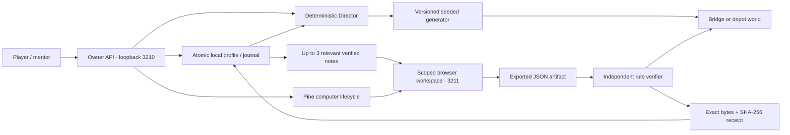

# NPC.exe system design

## Product contract

A local single-player environment where Pip operates a real Pine browser, exports an artifact, and returns to a world controlled by independent verification. The Director chooses increasingly demanding, reproducible tasks. Pip’s field journal persists and can be withheld for controlled comparisons. No automatic paid runs and no model-weight training.

## Architecture

Keep the existing modular Node/TypeScript server and React/Vite client. No new dependency, queue, database or orchestration framework. Two listeners preserve an actual security boundary: public workshop routes cannot reach owner operations.

## Three roles

- **Pip**: computer-using agent. Reads the task and optional prior notes, operates visible controls, writes a reflection, downloads a file. Browser-only behavior is a provider instruction, not an OS-enforced capability restriction.
- **World**: authoritative rules and consequences. A bridge needs connectivity and a valid ink budget; the depot needs exact reconciliation. It accepts bounded data, never executable code.
- **Director**: pure policy over current-level live results. Success with no rejected exports increases tier (maximum 3), a recovered/rejected export retains tier, failure reduces tier (minimum 1). A clean tier-3 success moves to the other mission at tier 1. No evidence or manual-only work yields a new same-tier variation. Cancellation is not evidence of inability.

## Determinism

Identity: `v1:<seed>:<episode>:<mission>:<tier>`. Seed has 1–40 ASCII letters/digits/hyphens/underscores; episode 1–999; tier 1–3. Hash text with 32-bit FNV-style multiplication, then use a fixed integer PRNG. Generation uses no clock or network.

Bridge generation tries at most 180 rock placements, retaining only placements that pass independent solvability checks. Tiers request 4/8/12 rocks and 12/11/10 ink respectively. The verifier separately checks the exported route. Revision is an artifact freshness token, not a random-generation input.

Depot generation creates 3/4/5 unique synthetic orders. Tier 2 inserts a repeated ID. Tier 3 also removes two stock units from the largest inventory category. Duplicate rows do not add demand. No production orders, personal addresses or external business system are involved.

Seeded replay reproduces the challenge, not AI decisions, cloud timing or the adaptive sequence. Every retained journal entry includes the full level description and generator version. Replay uses the retained current level; manual rock edits receive a custom identity and persist their full scene.

## Depot business rules

The CSV table and downloadable CSV share the same generated source records. Stock is visible in the browser. The worksheet starts at zero; there is no automatic fill or solution endpoint. Pip must read and reconcile it.

Only the first occurrence of each order ID counts. Process those unique orders in their original order. For each item, ship `min(requested, remaining stock)` and hold the remainder; subtract shipped quantity before the next order. Manifest schema contains version, kind, run ID, level ID, bounded entries and an optional 600-character reflection. The server independently recomputes expected allocation and rejects missing/duplicate/unknown orders, wrong quantities, extra fields or stale identity. Town deliveries are derived from accepted entries. Holds remain visible; unavailable parcels are not depicted as delivered.

## Journal and durability

`data/profile.json` is a strict version-1 snapshot of campaign and last 200 journey entries. Entries retain full level, source, outcome, note, receipt hash, duration, supplied note IDs, rejected export count and provider usage when reported. Only successful live entries with a receipt are recalled; up to three recent entries for the current mission. Fresh-Pip mode supplies zero entries while preserving history.

Successful artifacts may contain a reflection written by Pine in the browser. If absent, a clearly bounded procedure is derived from the mission rules. A verified artifact validates the task outcome, not every claim in a reflection. Notes are untrusted text and cannot override the server verifier.

Profile updates are serialized. Write a private temporary file, sync it, then atomically rename; publish the in-memory snapshot only afterward. Mode 0600 files under a 0700 data directory. Startup rejects malformed or >2MB profiles without overwriting them. Write failures show a journal warning while keeping the independently verified artifact result. Single-process ownership is required; this is not a concurrent multi-server database. Directory fsync and crash-time recovery of in-flight jobs are outside this local demo’s guarantees.

Artifacts and receipts are retained separately in `data/`; the 200-entry journal cap does not delete those evidence files. Back up the directory before editing or moving it. Active runs remain in memory. On restart the campaign and journal recover, but interrupted runs are not resumed. Pine’s idle lease bounds orphan lifetime.

## Lifecycle and security

- One active run, including import and computer cleanup. Level/memory changes freeze while work is active.
- Each run snapshots its level and selected notes. A random 192-bit capability exposes only that active workspace and expires when the run ends.
- The tunnel exposes 3211 only. Owner 3210 enforces local Host and same-origin/custom-header mutation checks. Campaign, journal, desktop delegation and imports are owner-only.
- Limits: 16KB artifact/request body, at most four candidate JSON artifacts, four-minute agent wall limit, six-minute outer deadline, 512K token allowance, 120-second idle lease. Stop/cancel in `finally` and graceful shutdown. No automatic retry loop.
- Project key and computer/session credentials stay on the server. The live view receives a short-lived view-only desktop token. Never put the key in Vite variables.
- Exact exported bytes are saved and hashed, including manual imports. Schemas reject additional control/code fields. Repeated identical imports are idempotent; overlapping imports are rejected.
- Async polling uses mutation generations so an older read cannot overwrite a newly confirmed user action.

## Measurement and limits

Journal comparisons match exact level identity and live source. Show latest fresh trial vs latest memory-on trial that actually received notes: result, time to verification/failure, provider cost and rejected exports. Unknown cost is a dash, not zero. No invented action count or percentage learned. Pair order, provider/model variation, browser latency and task familiarity are uncontrolled; claims about generalization require repeated held-out seeds.

The production opportunity is reproducible workflow testing for computer-using agents. The depot makes business data errors visible as missed deliveries. Transferring reliability claims to a real app requires separate validation.

## Change conditions

Move to transactional durable storage and jobs before multi-user/cloud hosting or concurrent server instances. Add explicit migrations for profile versions. Add learned curriculum selection only if the transparent policy proves inadequate. Add real business connectors only with a defined data boundary and separate validation; the current synthetic depot makes no such connection.
