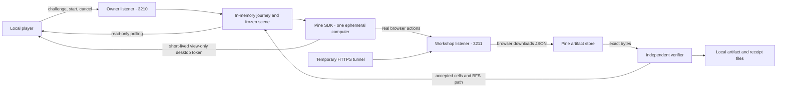

# System design

The system has one trusted application process, one untrusted artifact, and one externally operated computer.

The tunnel exposes 3211 only. The public listener serves static assets and the active capability-scoped workshop brief. It has no allocation, cancel, import, delegation, receipt or authoritative scene mutation route. Owner mutations also require a same-origin request and a custom header; Host validation blocks DNS rebinding. Tokens/keys are never bundled into the browser. Desktop delegation contains only a short-lived view token; reconnection obtains a fresh one.

A run snapshots the scene, generates a UUID and a random 192-bit workshop ticket, then freezes edits. Starting another run is refused until the current attempt and its resource cleanup finish. The workshop can paint data and download it; it cannot mark the game successful. In live mode, manual artifact submission is rejected. Only the server’s Pine adapter retrieves candidate downloads. Manual rehearsal uses the same verifier but carries a distinct source label.

The artifact parser accepts only `schemaVersion`, `runId`, `sceneRevision`, `color` and up to 12 unique in-bounds cells. The verifier checks identity/revision, requested color, budget, duplicates, islands, rocks and an orthogonal shore-to-shore path. Every returned animation step belongs to the independently found path. No downloaded code, SVG or HTML is executed. Reimporting the same accepted bytes is idempotent. Stale or malformed files leave the world unchanged.

The board is 12×8. The two leftmost and rightmost columns are land. Pip starts at (1,4); home is (10,4). Walking on land costs no ink; each bridge tile uses one unit. A bounded deterministic solvability check prevents the player from sealing the islands off entirely. It does not send a route to Pine. Up to 14 rocks can be placed between runs.

State transitions are `preparing → working → verifying → succeeded`, with `failed` or `canceled` exits. A completed agent turn alone is insufficient. No downloaded file means no bridge. Provider errors and cancellation always enter the cleanup path. A failed stop is shown as unconfirmed rather than successful; the computer has a 120-second idle lease. A process crash can still leave work running until its enforced limits/lease expire. Graceful termination cancels and waits for cleanup.

The desktop is optional evidence; a disconnected viewer does not kill the agent. The artifact is the authoritative result. Run logs and exact verified bytes persist in private local files. Active-state recovery across server restarts, authentication for multiple owners, durable billing limits and arbitrary web tools are outside this single-user demo. Move to durable run claims and encrypted credential storage before hosting for multiple users.

The agent is prompted to use the visible browser UI only. This is an instruction to the provider, not an OS-level tool allowlist. The server’s trust boundary and artifact checks hold even if the agent ignores that instruction. Activity and the live view provide demonstration evidence of how it worked.
